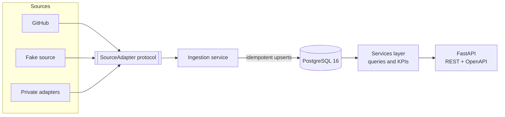

# devmetrics

An engineering metrics service. It ingests pull requests, review comments and bugs, stores them in PostgreSQL, and serves engineering KPIs (cycle time, review latency, bug rate, reviewer load) through a typed FastAPI API.

> **Status: early development.** The project skeleton, quality gates and domain models are in place. Ingestion, storage and the API are being built step by step. See [Roadmap](#roadmap).

## Why

Engineering KPIs are often compiled by hand once a month from exported spreadsheets. `devmetrics` replaces that with a service you can run, test and query: data is synced on a schedule, stored once, and every KPI comes from one tested SQL query.

## Architecture



- **Sources** plug in behind one `SourceAdapter` interface, so the rest of the service never knows where the data came from.
- **Only the ingestion service writes** to Postgres. Every row carries a unique `(source, external_id)` pair, which makes it safe to run a sync again.
- **Only the services layer reads**, so the API and later consumers share the same tested queries.

The public repository uses only GitHub and a seeded fake source. Adapters for other systems live in separate private packages that implement `SourceAdapter`.

## Tech stack

| Layer | Choice |
| --- | --- |
| Language and tooling | Python 3.12, uv, Ruff, mypy (strict), pytest |
| API | FastAPI, Pydantic v2 |
| Data | PostgreSQL 16 (pgvector image), SQLAlchemy 2.0 async, Alembic |
| HTTP client | httpx (async), tenacity |
| Scheduling | APScheduler with a Postgres advisory lock |
| Delivery | Docker multi-stage build, Docker Compose, GitHub Actions |

## Getting started

Requirements: [uv](https://docs.astral.sh/uv/) and `make`. uv installs Python 3.12 for you if it is missing.

```bash
git clone https://github.com/omarElsharkaawy/dev-metrics-service.git
cd dev-metrics-service
uv sync          # create .venv and install locked dependencies
make check       # lint, type check and tests
```

### Make targets

| Command | What it does |
| --- | --- |
| `make sync` | Install dependencies from `uv.lock` |
| `make fmt` | Format code and apply safe lint fixes |
| `make lint` | Check formatting and lint rules without changing files |
| `make typecheck` | Run mypy in strict mode |
| `make test` | Run the test suite |
| `make check` | Run lint, type check and tests together (the same gate CI will run) |
| `make help` | List all targets |

## Planned API

| Method and path | Purpose |
| --- | --- |
| `GET /health` | Liveness and database check |
| `GET /pull-requests` | Filter by repository, author, state and date range; cursor pagination |
| `GET /pull-requests/{id}` | One pull request with its comments |
| `GET /comments/search?q=` | Full-text search over review comments |
| `GET /kpis/cycle-time` | Median and 90th percentile time to merge, by week |
| `GET /kpis/review-latency` | Time to first review, by reviewer and by week |
| `GET /kpis/bug-rate` | Bugs per merged pull request, by month |
| `GET /kpis/reviewer-load` | Reviews done per reviewer in a period |
| `POST /sync` | Start a sync in the background; returns 202 and a run ID |
| `GET /sync/runs` | Recent sync runs and their status |

Every endpoint except `/health` will require an API key.

## Roadmap

| Step | What | Status |
| --- | --- | --- |
| S1 | Project skeleton and quality gates | ✅ Done |
| S2 | Domain models with Pydantic | ✅ Done |
| S3 | Source interface and fake source | ⬜ Next |
| S4 | GitHub source adapter | ⬜ |
| S5 | Reference KPI functions | ⬜ |
| S6 | Postgres schema and migrations | ⬜ |
| S7 | Idempotent ingestion and sync runs | ⬜ |
| S8 | REST API for pull requests and comments | ⬜ |
| S9 | KPI endpoints in SQL | ⬜ |
| S10 | Auth, scheduler and logging | ⬜ |
| S11 | Docker and Compose | ⬜ |
| S12 | CI pipeline | ⬜ |
| S13 | Docs, demo data and v0.1.0 release | ⬜ |

The full plan is in [docs/PLAN.md](docs/PLAN.md), and step-by-step progress is tracked in [docs/PROGRESS.md](docs/PROGRESS.md).

## Project layout

```text
src/devmetrics/     application package
src/devmetrics/domain/  typed, immutable domain models (Pydantic)
tests/unit/         fast tests with no external services
docs/               plan, progress log and (later) architecture decision records
```
